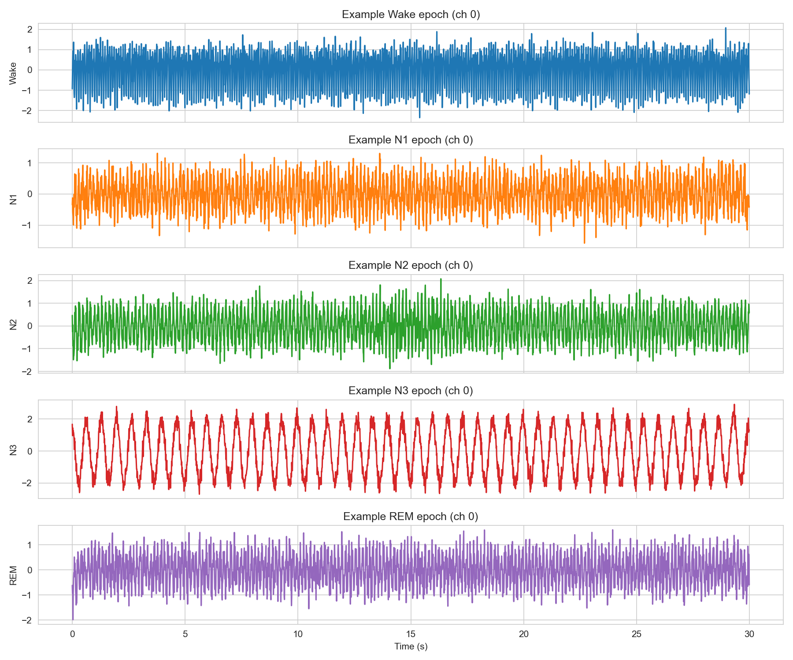
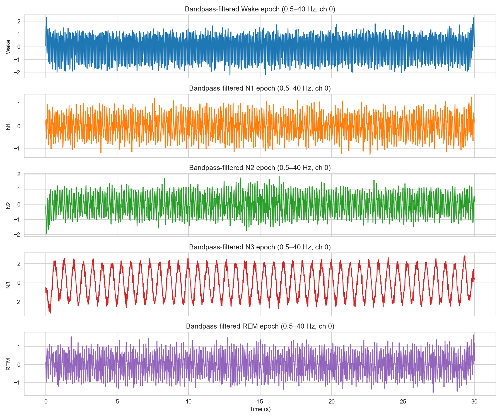
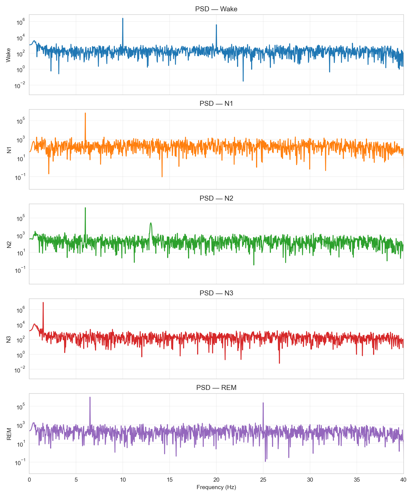
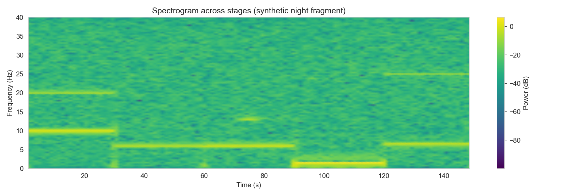
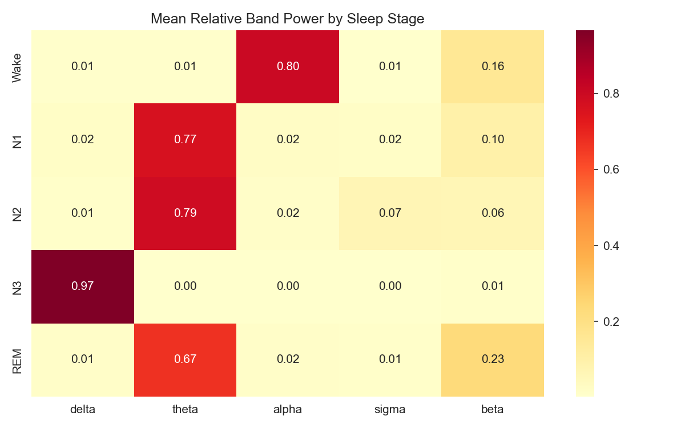
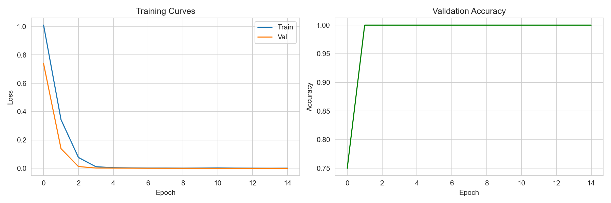
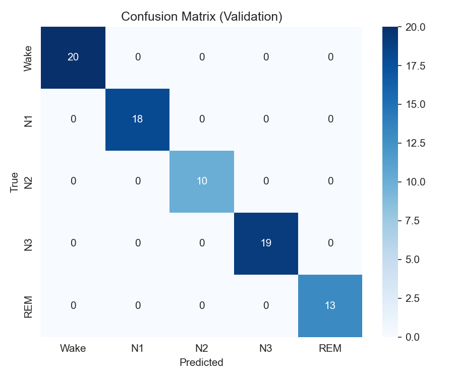
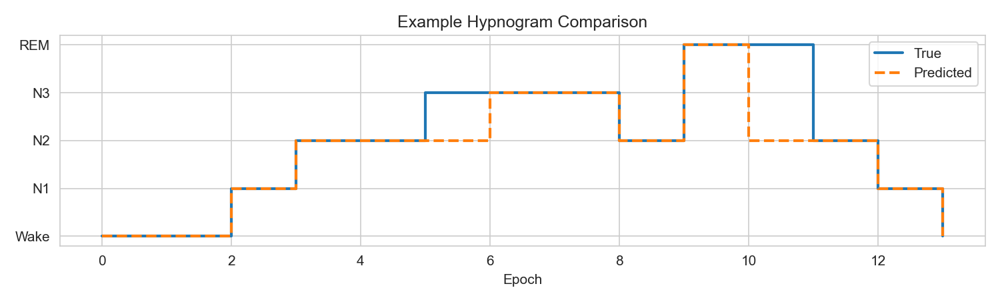

# Synthetic EEG Sleep Staging Demo

A self-contained Python demo that generates synthetic multi-channel EEG, applies digital signal processing, extracts classic spectral features, trains a compact PyTorch CNN inspired by EEGNet, and produces diagnostic visualizations.  

This repository is intended as a practical reference for the kinds of algorithms used in at-home EEG analysis (sleep staging, biomarker development, etc.).

## What the demo covers

- Synthetic generation of 30-second EEG epochs for the five standard sleep stages (Wake, N1, N2, N3, REM)
- Bandpass filtering (0.5–40 Hz)
- Power spectral density (PSD) and spectrogram visualization
- Relative band-power feature extraction
- A lightweight sequential CNN (temporal → depthwise spatial → separable convolution → classifier)
- Training, validation metrics, and a simple hypnogram comparison

All data are synthetic, so the stages are cleanly separable. The goal is to illustrate the full pipeline and visualization style rather than claim real-world accuracy.

## Requirements

```bash
pip install numpy matplotlib scipy seaborn torch scikit-learn
```

## How to run

```bash
python beacon_eeg_demo.py
```

The script creates a `plots/` directory and writes the figures listed below. Training runs on CPU in roughly 30–60 seconds.

## Pipeline overview

1. **Generate synthetic epochs**  
   Each 30 s epoch (100 Hz, 4 channels) is built from stage-specific sine waves plus noise:
   - Wake: alpha (~10 Hz) + beta (~20 Hz)
   - N1: theta (~6 Hz)
   - N2: theta + spindle burst (~13 Hz)
   - N3: large delta (~1.5 Hz)
   - REM: theta + higher-frequency activity

2. **Bandpass filter**  
   Zero-phase Butterworth filter, 0.5–40 Hz, applied to every epoch.

3. **Visualize time- and frequency-domain signals**  
   Raw epochs, filtered epochs, PSD per stage, and a concatenated spectrogram.

4. **Extract relative band power**  
   For each epoch, compute the fraction of total power in the classic bands  
   (delta 0.5–4 Hz, theta 4–8 Hz, alpha 8–12 Hz, sigma 12–15 Hz, beta 15–30 Hz).

5. **Train EEGNet-style CNN**  
   The model sees the filtered raw signal (shape: 1 × channels × time samples).

6. **Evaluate**  
   Training/validation curves, confusion matrix, and an illustrative hypnogram.

## Figures

### Raw synthetic epochs


One example epoch (first channel) for each sleep stage before filtering. Amplitude and dominant frequency already differ by stage.

### After bandpass filtering (0.5–40 Hz)


Same epochs after the 0.5–40 Hz filter. Slow-wave structure in N3 and higher-frequency content in Wake/REM become clearer.

### Power spectral density (one panel per stage)


Log-scale power spectrum of a representative filtered epoch.  
Characteristic peaks are easy to see:
- Wake: ~10 Hz and ~20 Hz
- N1: ~6 Hz
- N2: ~6 Hz plus spindle peak near 13 Hz
- N3: dominant peak near 1.5 Hz
- REM: theta plus higher-frequency activity

### Spectrogram of a synthetic night fragment


Time on the x-axis, frequency on the y-axis, color = power in decibels.  
Bright yellow horizontal bands are the dominant rhythms of each stage in sequence (Wake → N1 → N2 → N3 → REM). The green background is residual low-level noise (orders of magnitude weaker than the yellow bands).

### Mean relative band power


Each row is a sleep stage; each column is a frequency band. Values are the average fraction of total power in that band.  
N3 is almost pure delta; Wake is alpha-dominant; N1/N2 are theta-heavy; REM mixes theta and beta. These simple features already separate the stages well.

### Training curves


Loss and validation accuracy over 15 epochs. On this clean synthetic data the model reaches perfect validation accuracy quickly.

### Confusion matrix


Validation-set predictions versus true labels. All stages are classified correctly in this controlled example.

### Example hypnogram


A short sequence of true versus predicted stages. In real data this view is used to inspect sleep architecture and scoring disagreements.

## Model architecture (EEGNetSleep)

The network is a pure sequential stack (no parallel branches or concatenation):

1. **Temporal convolution**  
   Conv2d with kernel size (1, 51) → 16 filters.  
   Learns frequency-selective filters along the time axis.

2. **Depthwise spatial convolution**  
   Conv2d with kernel size (n_channels, 1) and groups equal to the number of temporal filters.  
   Combines information across EEG channels, followed by ELU, average pooling, and dropout.

3. **Separable convolution**  
   Depthwise temporal convolution + pointwise 1×1 convolution.  
   Extracts additional temporal patterns with few parameters, followed by ELU, pooling, and dropout.

4. **Classifier**  
   Flatten → linear layer → 5 class logits (Wake, N1, N2, N3, REM).

Input shape expected by the model: `(batch, 1, channels, time_samples)`.

This design follows the classic EEGNet idea of separating temporal (frequency) and spatial (channel) processing while remaining compact.

## Relative band-power calculation

For an epoch the power spectral density is estimated with Welch’s method.  
Relative power in a band is:

```
band_power / total_power
```

where total_power is the integral of the PSD over all frequencies, and band_power is the integral between the band’s low and high cutoffs. The value is then averaged across channels.

## Notes and limitations

- All signals are synthetic and intentionally easy to separate. Real overnight EEG contains artifacts, subject variability, and stage imbalance.
- The model is a minimal EEGNet-style reference, not a production sleep-staging system.
- No subject-wise cross-validation, artifact rejection, or multi-night modeling is included.
- Suitable as a starting point or teaching example; production work at companies such as Beacon Biosignals involves far larger datasets, rigorous validation, and regulatory documentation.

## File layout

```
beacon_eeg_demo.py          # complete runnable script
plots/
  01_raw_epochs.png
  02_bandpass_epochs.png
  03_psd_by_stage.png
  04_spectrogram.png
  04_band_power_heatmap.png
  05_training_curves.png
  06_confusion_matrix.png
  07_hypnogram.png
README.md
```

## License

This demo is provided as-is for educational and interview-preparation purposes.
